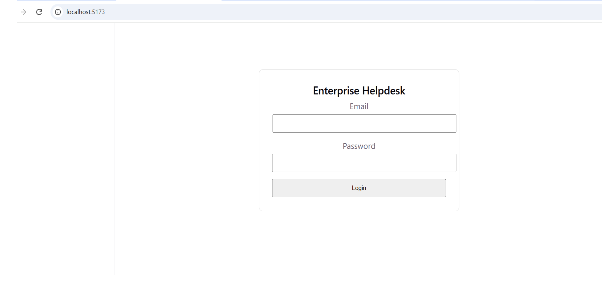
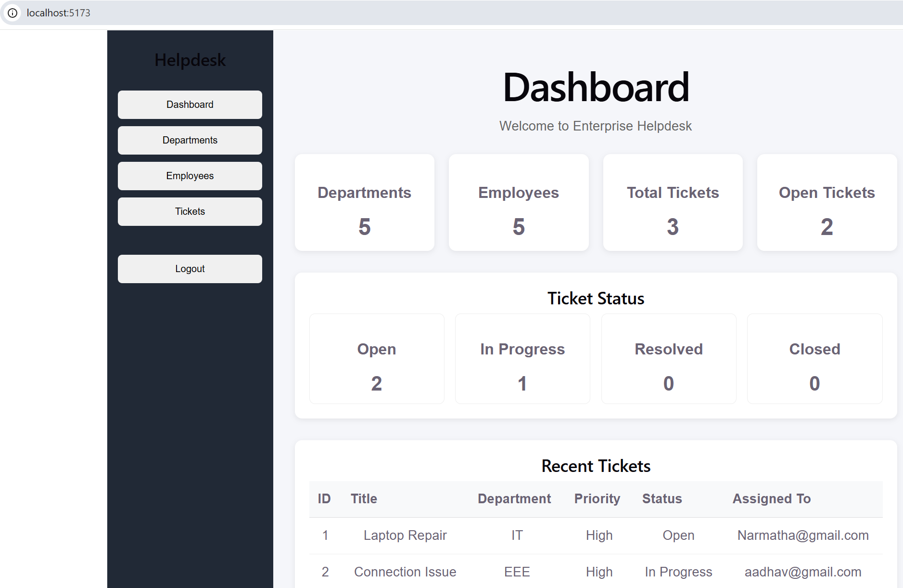
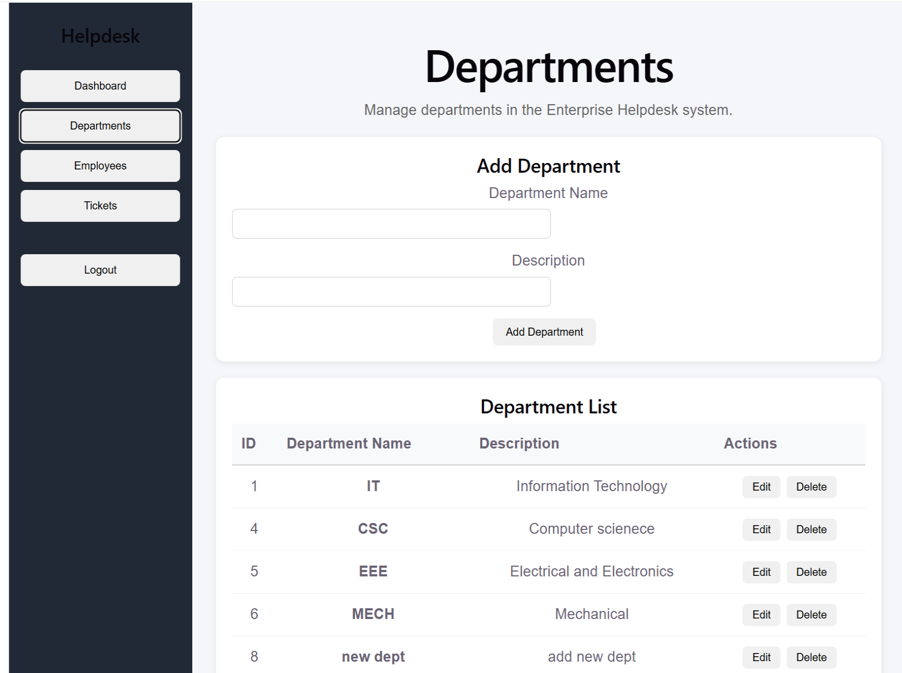
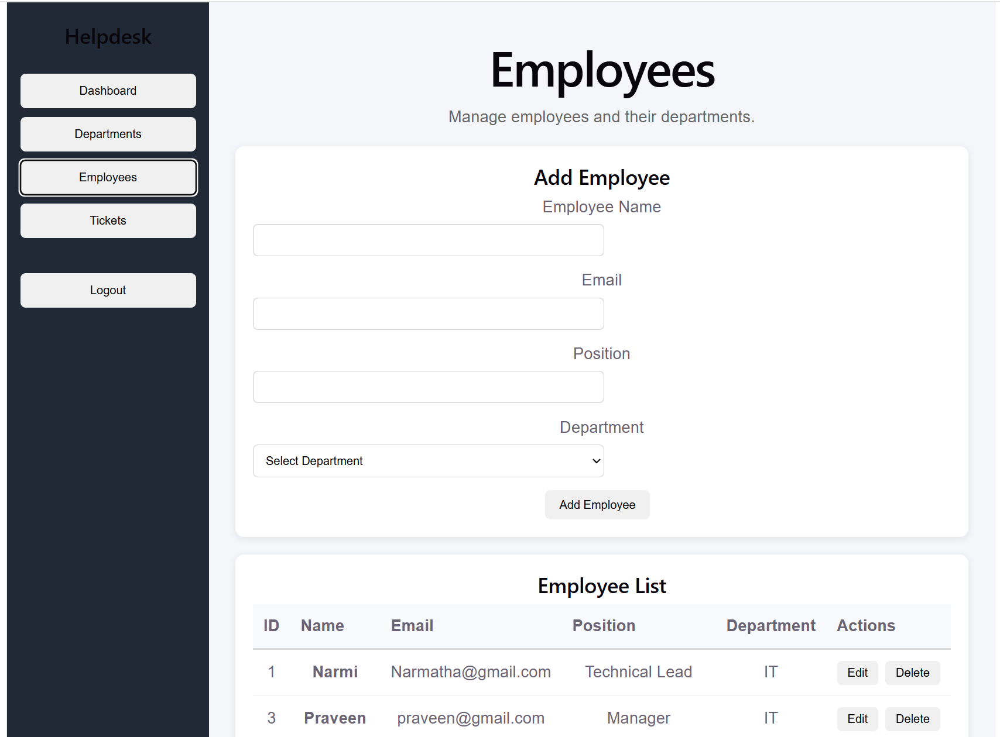
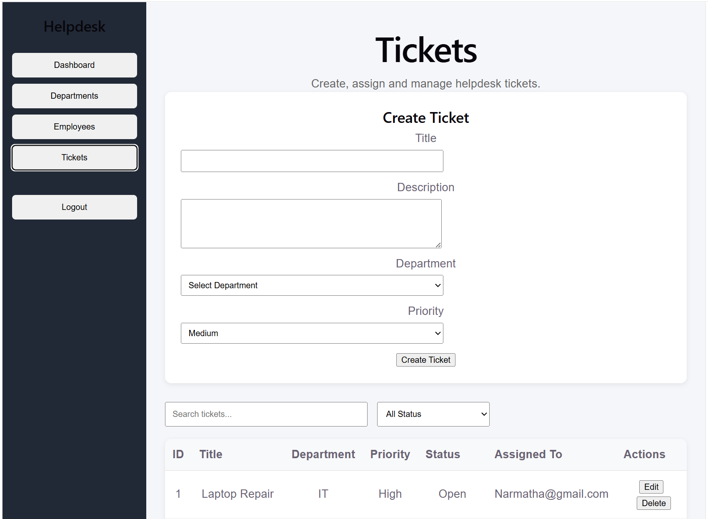

# Enterprise Helpdesk

[](https://github.com/Narmatha-Parasuraman/EnterpriseHelpdesk/actions)

A full-stack helpdesk management system for departments, employees and support tickets, with JWT authentication and role-based access control. Built with **ASP.NET Core Web API (Clean Architecture)**, **Entity Framework Core** and **React**, and deployed on **Azure** (Static Web Apps, App Service, Azure SQL, Key Vault) with **GitHub Actions**.

## Live demo

**https://black-bay-0db015c00.7.azurestaticapps.net**

| Role | Email | Password |
|------|-------|----------|
| Employee | `demo.employee@helpdesk.com` | `Helpdesk@12345` |

- The demo runs on Azure's free tier. **The first load after a quiet period can take up to a minute** while the server and database wake up. After that it is fast.
- Registration is restricted to Admins, so the Admin and Manager accounts are not shared. The Employee account above can create tickets and view departments and employees.

## Screenshots

| Login | Dashboard |
|-------|-----------|
|  |  |

| Departments | Employees |
|-------------|-----------|
|  |  |

| Tickets |
|---------|
|  |

## Features

- **Authentication:** login with JWT bearer tokens, ASP.NET Core Identity for users and passwords, Admin-only user registration and role assignment.
- **Departments:** create, view, update and delete.
- **Employees:** create, view, update and delete, linked to departments.
- **Tickets:** create, assign, change status and track tickets through `Open`, `InProgress`, `Resolved` and `Closed`.
- **Role-based authorization** enforced in the API, not only in the UI.

## Roles and permissions

| Action | Admin | Manager | Employee |
|--------|:-----:|:-------:|:--------:|
| View departments and employees | ✅ | ❌ | ✅ |
| Create or edit departments and employees | ✅ | ❌ | ✅ |
| Delete departments and employees | ✅ | ❌ | ❌ |
| View tickets | ✅ | ✅ | ✅ |
| Create a ticket | ❌ | ❌ | ✅ |
| Edit, assign or change status of a ticket | ✅ | ✅ | ❌ |
| Delete a ticket | ✅ | ❌ | ❌ |
| Register users and assign roles | ✅ | ❌ | ❌ |

## Architecture

The solution follows **Clean Architecture**: dependencies point inward, and the domain has no framework dependencies.

```text
EnterpriseHelpdesk
├── EnterpriseHelpdesk.API             Controllers, authentication and API configuration
├── EnterpriseHelpdesk.Application     DTOs, interfaces and services (business logic)
├── EnterpriseHelpdesk.Domain          Entities and enums
├── EnterpriseHelpdesk.Infrastructure  EF Core DbContext, migrations, repositories, identity
├── EnterpriseHelpdesk.Tests           xUnit test project
└── EnterpriseHelpdesk.Web             React (Vite) frontend
```

```text
React (Azure Static Web Apps)
        │  HTTPS + JWT
        ▼
ASP.NET Core Web API (Azure App Service)
        │
        ▼
Application services → Repositories → EF Core
        │
        ▼
Azure SQL Database (production)  /  SQLite (local development)
```

## Tech stack

| Layer | Technology |
|-------|------------|
| Backend | ASP.NET Core Web API, .NET 10, C#, Entity Framework Core, ASP.NET Core Identity, JWT, Swagger (development only) |
| Frontend | React, JavaScript, Axios, Vite |
| Database | Azure SQL (production), SQLite (local development) |
| Cloud | Azure App Service, Azure Static Web Apps, Azure SQL Database, Azure Key Vault |
| CI/CD | GitHub Actions (separate workflows for the API and the frontend) |

## Azure deployment

- **Frontend:** built and deployed to Azure Static Web Apps by a GitHub Actions workflow on every push to `main`.
- **API:** built, published and deployed to Azure App Service by a second workflow, which signs in to Azure with OIDC (no stored passwords).
- **Database:** Azure SQL in production. The app switches between Azure SQL and SQLite depending on the environment.
- **Secrets:** the SQL connection string and the JWT signing key are stored in Azure Key Vault and referenced from the App Service settings through the app's managed identity. No secrets are committed to the repository.
- **Startup:** database seeding (roles and the first Admin) runs in the background, so a sleeping free-tier database cannot stop the API from starting. A `/api/health` endpoint lets the login page wake the server while the user types.

## API overview

| Endpoint | Method | Access |
|----------|--------|--------|
| `/api/Auth/login` | POST | Public |
| `/api/Auth/register` | POST | Admin |
| `/api/Auth/assign-role` | POST | Admin |
| `/api/Departments` | GET, POST | Admin, Employee |
| `/api/Departments/{id}` | GET, PUT | Admin, Employee |
| `/api/Departments/{id}` | DELETE | Admin |
| `/api/Employee` | GET, POST | Admin, Employee |
| `/api/Employee/{id}` | GET, PUT | Admin, Employee |
| `/api/Employee/{id}` | DELETE | Admin |
| `/api/Ticket` | GET | Any signed-in user |
| `/api/Ticket` | POST | Employee |
| `/api/Ticket/{id}` | PUT | Admin, Manager |
| `/api/Ticket/{id}/assign` | PUT | Admin, Manager |
| `/api/Ticket/{id}/status` | PUT | Admin, Manager |
| `/api/Ticket/{id}` | DELETE | Admin |

More detail is in [`docs/api.md`](docs/api.md) and [`docs/architecture.md`](docs/architecture.md).

## Run it locally

**Prerequisites:** .NET 10 SDK and Node.js (LTS).

```bash
git clone https://github.com/Narmatha-Parasuraman/EnterpriseHelpdesk.git
cd EnterpriseHelpdesk
```

**1. API** (uses SQLite locally; secrets are kept out of the repo with user-secrets)

```bash
cd EnterpriseHelpdesk.API
dotnet user-secrets init
dotnet user-secrets set "Jwt:Key" "<a random string of at least 32 characters>"
dotnet user-secrets set "Admin:Email" "admin@example.com"
dotnet user-secrets set "Admin:Password" "<a strong password>"
dotnet run --launch-profile http
```

The API listens on `http://localhost:5104`, and Swagger is at `http://localhost:5104/swagger` in development.

**2. Frontend** (in a second terminal)

```bash
cd EnterpriseHelpdesk.Web
npm install
npm run dev
```

Open `http://localhost:5173`. The frontend reads the API address from `.env.development` (local) and `.env.production` (deployed).

## Roadmap

- Unit tests (xUnit) for the application services, run in the CI pipeline.
- Ticket search, filtering and pagination, and comments on tickets.
- Docker support.
- Application Insights monitoring.

## Author

**Narmatha Parasuraman** · [GitHub](https://github.com/Narmatha-Parasuraman)

Built to demonstrate modern .NET development: Clean Architecture, REST APIs, JWT authentication and authorization, React integration, and automated deployment to Azure.
